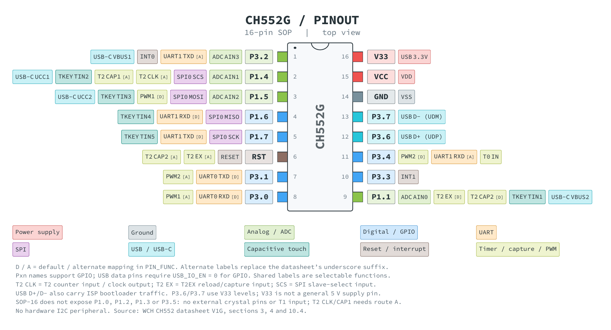

# CH552G pinout

Colour-coded pinout for the WCH CH552G in the SOP-16 package, viewed from
above. The drawing follows the same style as the AVR128DA28 diagram and
separates physical pins, peripheral functions and group colours.



## Files

- `ch552g.tex`: package geometry, pin numbers, function labels and legend.
- `pins.tex`: physical pin number, name, base group and function list.
- `groups.tex`: one RGB colour and legend label per group.
- `ch552g.pdf`, `ch552g.svg`, `ch552g.png`: generated diagram.
- `/assets/pinout2.png`: the PNG used by the repository README.

The contact and pin name use the base group colour; each function label uses
its own group's colour. GPIO is implicit for names such as P1.4 and P3.2.
Colours identify power, ground, analog, digital, UART, SPI, USB/USB-C,
capacitive touch, reset/interrupt and timer/capture/PWM functions.

## Pin data

```tex
\Pin{11}{P3.4}{digital}{%
  \Function{timer}{}{PWM}{2}{D}
  \Function{uart}{UART1}{RXD}{}{A}
  \Function{timer}{T0}{IN}{}{}}
```

`\Pin` receives the physical number, pin name, base group and functions.
`\Function` receives the group, peripheral instance, signal, channel and
mapping. The channel, instance or mapping may be empty where not applicable.

- `D`: default pin mapping, with the corresponding `PIN_FUNC` mapping bit clear.
- `A`: alternate mapping, with that bit set. It replaces the datasheet's
  underscore suffix, which denotes remapping rather than an active-low signal.
- No mapping label: the pin function has no selectable pin remapping.

Each mapping bit applies to its own function: `bUART1_PIN_X`, `bPWM1_PIN_X`,
`bPWM2_PIN_X`, `bT2_PIN_X` or `bT2EX_PIN_X`. UART0's default pins are
P3.0/P3.1; its alternate pins P1.2/P1.3 are not exposed in this package.

## Package-specific details

The assignments were checked against the repository's [WCH CH552 datasheet,
version 1G](/doc/datasheets/CH552.pdf), sections 3, 4 and 10.4.

- The CH552G exposes 16 pins. Do not use the CH552T, CH552P or CH551G pinout.
- ADC AIN0/1/2/3 are on P1.1/P1.4/P1.5/P3.2 respectively.
- UART1 RXD/TXD default to P1.6/P1.7 and can move to P3.4/P3.2.
- SPI0 uses SCS/MOSI/MISO/SCK on P1.4/P1.5/P1.6/P1.7. SCS is the slave-select input.
- T0 has an external input on P3.4. T1 still exists internally, but its
  external input P3.5 is not exposed.
- T2 CLK denotes the T2 counter input/clock output; T2 EX denotes T2EX.
  CAP1 and CAP2 are the two Timer2 capture inputs.
- T2/CAP1 require alternate mapping to P1.4 because default P1.0 is not exposed.
  T2EX/CAP2 use P1.1 by default and can move to RST.
- The available touch inputs are TIN1 through TIN5; TIN0's P1.0 is not exposed.
- UCC1/UCC2 and VBUS1/VBUS2 are USB Type-C detection functions.
- UDP/UDM are USB D+/D- and carry USB ISP bootloader traffic as well.
  These pins require `bUSB_IO_EN = 0` for GPIO operation and use V33 levels.
- V33 is the USB regulator output/internal USB supply input. At VCC below
  3.6 V, connect V33 to VCC; above 3.6 V, decouple V33 with 100 nF as specified
  by the datasheet. It is not a general-purpose 5 V supply pin.
- P1.2/P1.3 (XI/XO) are not exposed, so this package has no external crystal
  pins. There is no hardware I2C peripheral; software I2C uses GPIO.

Function labels show available configurations, not simultaneous connections.
For functions sharing a pin, peripheral enables and priority also apply;
see the GPIO alternate-function table in section 10.4.

## Build

Requires `pdflatex` with TikZ and Source Code Pro, `pdf2svg`, and Poppler's
`pdftoppm`. The Makefile includes the usual macOS TeX and Homebrew paths.

From the repository root:

```sh
make -C doc/pinout build
```

The build produces PDF, SVG and a PNG at 200 dpi, then copies the PNG to
`assets/pinout2.png`, preserving the main README's existing image path.
The diagram is schematic, not a physical package drawing. Each rectangular
contact is 4 x 4 mm, with 8 mm between centres in the drawing.

Edit `pins.tex` to change pin/function data, `groups.tex` to change colours,
and `ch552g.tex` to change layout. Re-run the build to update all outputs.
