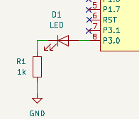
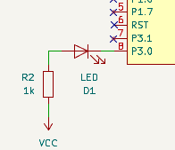

# Blink

## Description

Turn an LED on and off using pin P3.0.

This example demonstrates two ways to connect an LED: **active-high** and **active-low**. It also explains how the CH552 GPIO pins behave during startup.

## Schematic

### Active-high



The LED is connected between the GPIO pin and GND, with a current-limiting resistor.

- `HIGH (1)` turns the LED **ON**.
- `LOW (0)` turns the LED **OFF**.

### Active-low



The LED is connected between VCC and the GPIO pin, with a current-limiting resistor.

- `LOW (0)` turns the LED **ON**.
- `HIGH (1)` turns the LED **OFF**.

## Features

- One LED output on P3.0.
- Supports active-high and active-low connections.
- Uses a blocking delay between changes.
- Demonstrates basic GPIO control.

## Additional information

### GPIO behavior at startup

The CH552 is based on the 8051 architecture.

After a reset, the GPIO port registers are initialized to `1` (HIGH). By default, the ports use a quasi-bidirectional mode with internal pull-up behavior.

This means the pins are not necessarily driving a strong HIGH signal, but they can provide a weak pull-up current.

Depending on the LED connection, this can cause unexpected behavior during startup:

- **Active-high:** The LED may turn on or glow because the GPIO starts HIGH.
- **Active-low:** The LED normally remains off because the GPIO starts HIGH.

For this reason, active-low is often a better choice when the LED should remain off during startup.

### Avoiding unwanted LED activation

To avoid unexpected behavior, initialize the GPIO before starting the main loop.

For an active-high LED, initialize the output to LOW.

For an active-low LED, initialize the output to HIGH.

Keep in mind that software initialization cannot control the pin before the firmware starts running. If the startup state is critical, use an appropriate external circuit.

### Toggling the LED

The main loop toggles the GPIO state every second:

```c
LED = !LED;
delay_ms(1000);
```

You can also control the LED directly using `0` and `1`.

The LED behavior depends on the connection:

| GPIO value | Active-high | Active-low |
|------------|-------------|------------|
| `0` (LOW)  | OFF         | ON         |
| `1` (HIGH) | ON          | OFF        |

### Recommendation

For simple LED projects, both connections are valid.

If you want the LED to remain off during startup, **active-low is generally preferred** on the CH552.

However, the actual startup behavior depends on the GPIO configuration, LED circuit, and any code executed by the bootloader.
